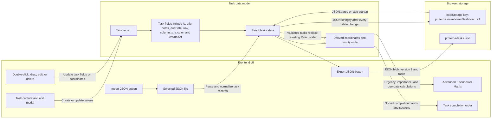

# Proteros
Use of custom Advanced Eisenhower Matrix to prioritize tasks and foci on Urgency, Importance, and Various other factors

The whole ideas is that each quadrant has a set of coordinates 50x50 that denote where EXACTLY on the urgency scale and Importance scale the task lies. 

## Urgency Y coordinates and due dates

Each task uses a 50-point coordinate system. The Y coordinate is stored as an integer from `0` through `49`, where `0` is the top of an urgent square and `49` is the bottom. The urgent-row guide lines map to:

| Y range | Urgency window | Due-date rule |
| --- | --- | --- |
| `0-10` | Within one day | The Y position is converted to an hour in the next 24 hours. |
| `10-20` | One day to one week | The due date is midnight, with the position mapped across days 1 through 7. |
| `20-30` | One to two weeks | The due date is midnight, with the position mapped across days 7 through 14. |
| `30-40` | Two to three weeks | The due date is midnight, with the position mapped across days 14 through 21. |
| `40-49` | Three weeks to one month | The due date is midnight, with the position mapped across days 21 through 30. |

The due date is stored on the task as an ISO timestamp. A task created by double-clicking the matrix receives a due date based on its initial Y position. Tasks in the first-day range retain an hour-level deadline; deadlines in all later ranges are set to local midnight.

After creation, an urgent task's displayed Y position is calculated from its due date and the current time rather than remaining fixed. The dashboard refreshes this calculation every minute, so tasks move upward as their deadlines approach. Overdue tasks clamp to the top (`Y=0`), and tasks more than 30 days away clamp to the bottom (`Y=49`). Dragging an urgent task changes both its Y coordinate and due date; editing the due date likewise changes its displayed Y position when the task is saved. The X coordinate and importance-column behavior are independent of this time calculation. Tasks in the non-urgent row retain their manually positioned Y coordinate.

## Frontend data flow

The application keeps task records in React state, derives the matrix and priority views from those records, and persists the state to browser `localStorage`.

The export format is an object containing `version: 1` and the current `tasks` array. Import accepts that export format or a top-level task array. It validates and normalizes task records, replaces the React task state with valid tasks, and lets the existing `useEffect` persist the replacement to `localStorage`.

# DEVELOPMENT - React + Vite

This template provides a minimal setup to get React working in Vite with HMR and some ESLint rules.

Currently, two official plugins are available:

- [@vitejs/plugin-react](https://github.com/vitejs/vite-plugin-react/blob/main/packages/plugin-react) uses [Oxc](https://oxc.rs)
- [@vitejs/plugin-react-swc](https://github.com/vitejs/vite-plugin-react/blob/main/packages/plugin-react-swc) uses [SWC](https://swc.rs/)

## React Compiler

The React Compiler is not enabled on this template because of its impact on dev & build performances. To add it, see [this documentation](https://react.dev/learn/react-compiler/installation).

## Expanding the ESLint configuration

If you are developing a production application, we recommend using TypeScript with type-aware lint rules enabled. Check out the [TS template](https://github.com/vitejs/vite/tree/main/packages/create-vite/template-react-ts) for information on how to integrate TypeScript and [`typescript-eslint`](https://typescript-eslint.io) in your project.

FAQ:
What happens to the user's existing data when we update the data model for tasks (the json structure)?

Existing task data is stored in the browser’s localStorage under proteros.eisenhowerDashboard.v1 (App.jsx:4).

When the task model changes:

Existing JSON records are loaded unchanged; there is no migration or schema-version conversion (App.jsx:187).
Missing fields generally use UI fallbacks—for example, default coordinates, notes, or color when editing/displaying tasks.
Updated tasks retain their existing fields and receive the new values when edited (App.jsx:307).
If the storage key or data format is deliberately changed, old data will no longer be loaded automatically.
If stored JSON is malformed, the app treats it as an empty task list and then overwrites storage, which can discard the unreadable data (App.jsx:188).
Users can manually preserve their data using the JSON export feature (App.jsx:430).
So, there is currently no formal migration strategy; compatible old records remain, but incompatible schema changes could require adding migration logic.
